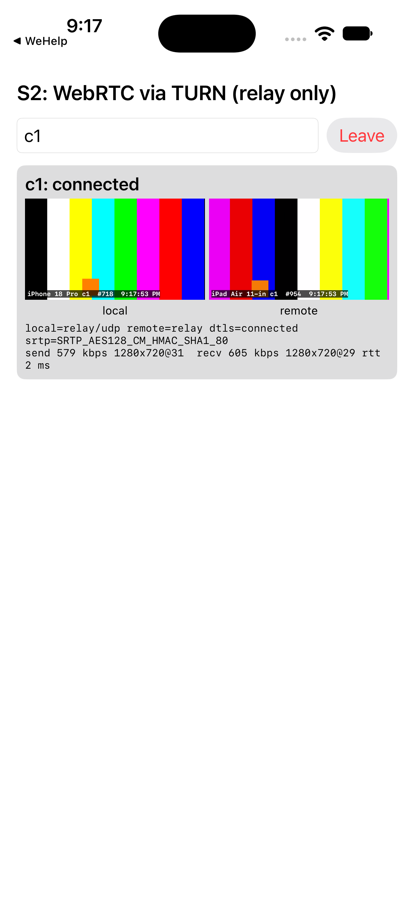
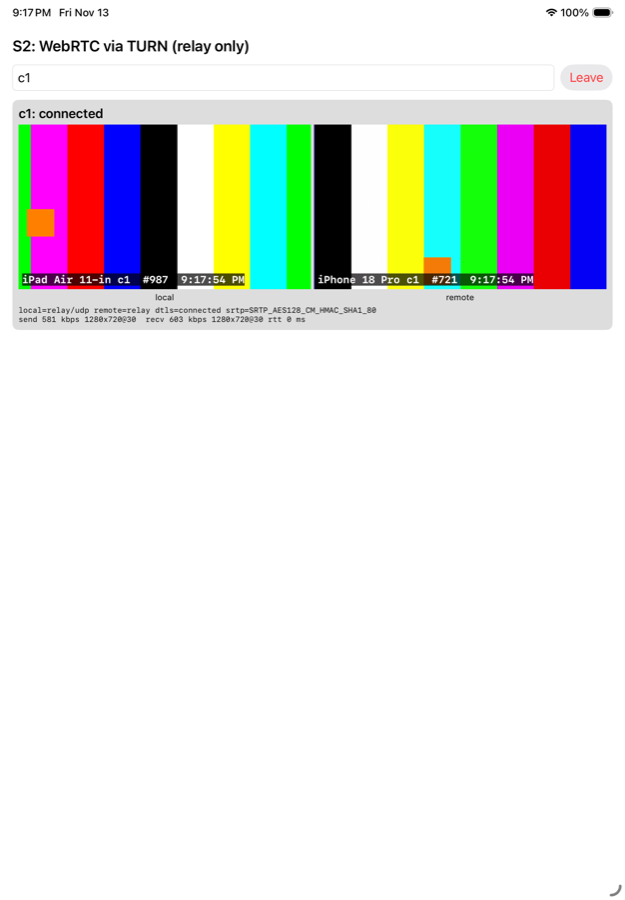
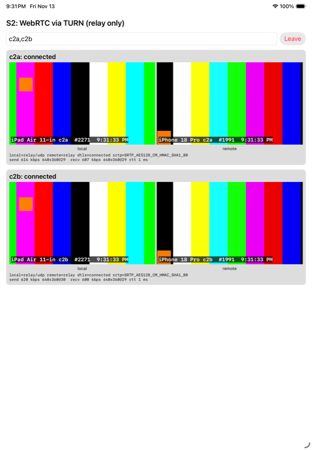

# Spike S2: 1:1 WebRTC through pion/turn (#33)

## Answer: yes

Two iOS clients held 1:1 WebRTC video calls with
`iceTransportPolicy = .relay` through a pion/turn server we ran. Every
connected stats report on both sides showed `relay` ↔ `relay` candidates over
UDP. DTLS 1.3 and SRTP were in use, and the DTLS certificate each client
negotiated matched the fingerprint in the other client's SDP. So the TURN
server only forwarded ciphertext. One call and then two calls at once each
ran for 10 minutes with no packet loss and no drops.

The server cost is small: about 3% of one M3 core and 13 MB RSS for one call,
and about 6% and 14 MB for two. The WebRTC dependency adds about 12 MB
installed and about 5.5 MB to the download (BSD-3). It is acceptable.

**Caveat:** this used two simulators on the same Mac as the server, so no
real Wi-Fi was in the path, there was no camera and no audio. The simulator's
H.264 encoder also throttles itself (see Problems). The plumbing, security
and server cost are proven. Video quality, bitrate and battery on real phones
are not. A short test on two physical iPhones is recommended early in V1-M4
(see the section on physical devices).

## Setup

| | |
|---|---|
| Laptop | Apple M3, 8 cores, 16 GB, macOS (Darwin 27.2), LAN IP 192.168.1.20 |
| Clients | iPad Air 11-inch (M4) simulator and iPhone 18 Pro simulator, Xcode 27.2 |
| Server | `spikes/s2/server`: Go 1.26, `github.com/pion/turn/v5` v5.1.3 |
| TURN | UDP and TCP on 192.168.1.20:3478, relay ports 49160-49999, TURN REST long-term credentials (`LongTermTURNRESTAuthHandler`), 1 hour, minted per join |
| Signaling | Same binary: HTTP long-poll (`/join`, `/send`, `/poll`, `/report`) on :8733. Spike only; V1 signals through the Back Office |
| App | `spikes/s2/ios`: SwiftUI, xcodegen, iOS 17, `com.zacelston.wehelp.spike2`, team WZYFJ8TSWD |
| WebRTC | `stasel/WebRTC` 157.0.0 via SwiftPM (Chromium M157 libwebrtc) |
| ICE config | `iceTransportPolicy = .relay`, unified plan, max-bundle, rtcp-mux required |
| Video source | Simulator: a generated 1280x720 at 30 fps test pattern (scrolling colour bars, moving box, frame counter) fed to `RTCVideoSource`. Device: front camera through `RTCCameraVideoCapturer`, plus a microphone track |
| Codec | H.264 negotiated, `VideoToolbox` encoder and decoder on both sides |

The server logs:

- each TURN allocation, permission and channel bind;
- bytes and packets per allocation, sorted by first byte (RFC 7983) into STUN,
  DTLS and SRTP/SRTCP;
- process CPU (getrusage delta), RSS and heap every 10 s.

Each client posts a stats summary every 5 s, and the server logs it:

- the selected candidate pair types;
- DTLS state, version and cipher, and the SRTP cipher;
- the remote certificate fingerprint;
- bitrate, resolution, frame rate, RTT, loss and the quality limitation
  reason.

`spikes/s2/sample.sh` samples CPU time and RSS of the server and both app
processes every 10 s (simulator apps are ordinary macOS processes).

Rerun steps are in [spikes/s2/README.md](../../spikes/s2/README.md).

## Evidence that media goes through TURN

From `docs/spikes/s2/server-one-call-start.log`:

```
turn allocation created src=192.168.1.20:59356 proto=UDP user=c1-789042ae relay=192.168.1.20:49749
turn allocation created src=192.168.1.20:49648 proto=UDP user=c1-eb3aee1e relay=192.168.1.20:49644
turn channel bound user=c1-789042ae relay=192.168.1.20:49749 peer=192.168.1.20:49703 channel=16384
```

At the end of the 10-minute single call (`server-one-call-end.log`), the two
active relays had each forwarded about 46 MB each way:

```
relay user=c1-eb3aee1e relay=:49644 age=10m25s in_bytes=45746357 out_bytes=46129713 classes="stun=1012 dtls=0 srtp=136253 other=0"
relay user=c1-789042ae relay=:49749 age=10m25s in_bytes=46144287 out_bytes=45747387 classes="stun=1020 dtls=4 srtp=136271 other=0"
```

On the client side, 1,078 stats reports came in while connected over all
runs. Every one of them showed `localCandidateType=relay
remoteCandidateType=relay localRelayProtocol=udp`. With `.relay` policy,
libwebrtc does not gather host or srflx candidates, so the two apps never had
a direct path to try.

## Evidence that media is DTLS-SRTP end to end

1. **SDP:** every offer and answer used `UDP/TLS/RTP/SAVPF` with an
   `a=fingerprint:sha-256 ...` line. No SDP offered plain `RTP/AVP`
   (`plain_rtp_avp=false` on every `signal sdp` line).
2. **Negotiated state:** both sides reported `dtlsState=connected`,
   `tlsVersion=FEFC` (DTLS 1.3), `dtlsCipher=TLS_AES_128_GCM_SHA256` and
   `srtpCipher=SRTP_AES128_CM_HMAC_SHA1_80`.
3. **No man in the middle:** the server compared the remote certificate
   fingerprint from each client's `getStats` with the `a=fingerprint` the
   other client put in its own SDP.
   - 948 reports were compared, and all 948 matched
     (`remote_fp_matches_peer_sdp=true`). None failed.
   - The remaining 130 connected reports, all from one peer in the
     single-call run, did not include the remote certificate. This was a
     spike bug in how the stats entry was picked. Its partner's check passed,
     and so did both directions of the other four calls.

   A TURN server that terminated DTLS would have to present its own
   certificate, and the check would fail.
4. **On the wire at the relay:** after the 4 DTLS handshake packets per
   call, every relayed payload began with 128-191 (SRTP/SRTCP). Nothing fell
   into the `other` class.
   - The TURN server sees RTP headers (SSRC, sequence numbers, timestamps,
     header extensions) and packet sizes and timing.
   - It never sees media or keys: the SRTP keys come from the DTLS handshake
     between the two apps.

In V1 the fingerprints travel in the SDP over each party's pinned Back
Office channel. That is what stops the Relay from swapping them
(ARCHITECTURE.md → Telehealth).

## Measurements

"Relayed" is the media the TURN server forwarded: one direction of A→B plus
B→A. The `relay_kbps_total` counter in the log counts each packet twice (out
of one allocation and into the other), so it is halved here. The server CPU
figure is a percentage of one core.

| Run | Duration | Server CPU | Server RSS | Relayed media | Each app CPU | Each app RSS (avg / peak) | Video received | Loss | RTT |
|---|---|---|---|---|---|---|---|---|---|
| 1 call | 10 min | 2.8% | 11-13 MB | 1.14 Mbit/s avg (0.55 each way), 2.1 peak | 34-38% | 96-105 / 228-252 MB | 30 fps, 720p for the first minute, then down to 180p (see Problems) | 0 packets | 0-5 ms typical, one 120 ms spike |
| 2 calls at once | 10 min | 5.6% | 13-14 MB | 2.29 Mbit/s avg, 4.1 peak | 47-49% (each app ran both calls) | 145-151 / 413-508 MB | 30 fps, same step-down | 0 packets | 0-5 ms typical, max 83 ms |
| 2 calls, `-keepResolution YES` | 5 min | 1.5% | 11-14 MB | 0.68 Mbit/s avg | 35-37% | 298-308 / 518-553 MB | 720p held, but the frame rate fell to 2-5 fps | 0 packets | 1-2 ms typical, max 34 ms |

How the runs were set up:

- Raw samples are in `docs/spikes/s2/*.csv`, summarised with
  `spikes/s2/summarize.sh`.
- "Two calls at once" means each simulator ran two peer connections (rooms
  `c2a` and `c2b`). That gives four endpoints, four active allocations and
  two independent DTLS sessions on the server. Only two simulators were in
  scope.
- About 110 packets per second each way per call at about 550 kbit/s.

What this says about the server:

- The cost is per packet and grows linearly: about 2.5% of a core per
  Mbit/s forwarded on an M3.
- **Estimate, not measured:** a real 720p camera call at 1.5-2.5 Mbit/s each
  way would cost about 8-12% of a core per call. Two calls would cost about
  20%, with RSS still under 20 MB. That is fine for the Relay, a small VPS.
- Bandwidth on the Relay is the real cost. Every byte comes in from one
  phone and goes out to the other. A 720p call is about 3-5 Mbit/s in and
  the same out.
- When both phones are on the office Wi-Fi, the traffic hairpins: office →
  Relay → office. It uses the office uplink in both directions.

## The WebRTC package

| | |
|---|---|
| Package | [stasel/WebRTC](https://github.com/stasel/WebRTC), SwiftPM `binaryTarget`, pinned `exactVersion: 157.0.0` (published 2026-11-05) |
| What it is | Unmodified Google libwebrtc (Chromium milestone M157) built as an xcframework: iOS arm64, simulator arm64/x86_64, Mac Catalyst, macOS |
| Licence | BSD-3-Clause (the WebRTC project licence, shipped as `LICENSE` in the xcframework; GitHub shows `NOASSERTION`). libwebrtc also bundles third-party code (BoringSSL, libvpx, libyuv, Opus, abseil, and others) with their own permissive licences. The app needs an acknowledgements screen |
| Privacy manifest | Included (`PrivacyInfo.xcprivacy`) |
| Download | 46.4 MB zip (all slices). Downloaded once by SwiftPM and cached; CI pays this per cold cache |
| Size in the app | `WebRTC.framework` (ios-arm64) is 12.0 MB on disk out of 12.4 MB for the whole Release spike app. The zipped Release `.app` is 5.9 MB, so about 5.5 MB is WebRTC. App Store thinning does not shrink it further; it is already arm64-only |
| Update cadence | Follows Chrome milestones, roughly monthly: 146 (2026-03) → 157 (2026-11), 11 releases in 8 months. There was a gap from 141 (2025-10) to 146 (2026-03), when no build came out for about 5 months |
| Maintenance risk | A community project (one main maintainer, about 630 stars). The binary is fetched from GitHub Releases and checked by a SwiftPM checksum |

**Verdict: adopt for V1, with guardrails.**

- Pin an exact version. The tag's `Package.swift` pins the zip checksum.
- Mirror the xcframework zip in our own release storage, so that a deleted
  upstream release cannot break builds.
- Track libwebrtc security fixes. Update at least each quarter, and at once
  for a CVE in DTLS, SRTP or the codecs.
- Keep the fallback in mind: libwebrtc can be built ourselves with Google's
  `build_ios_libs.py` if the package stalls again. That takes about an hour
  of CI and depot_tools.

## Problems hit

1. **The simulator H.264 encoder throttles itself.**
   - In every simulator run, WebRTC's CPU-overuse detector stepped the
     outgoing resolution down 720p → 540p → 360p → 270p → 180p, about once a
     minute, and stayed at 180p (`qualityLimitationReason=cpu`). It did the
     same with one call or two.
   - The host was not saturated: each app used about 35-50% of one core on
     an 8-core M3.
   - With `degradationPreference = maintainResolution`, it held 720p but
     dropped to 2-5 fps.
   - So the cause is the simulator's VideoToolbox encode latency, not load.
     Simulators cannot measure video quality or realistic bitrate. The
     bandwidth numbers above are therefore low (about 0.55 Mbit/s each way,
     against an expected 1.5-2.5 for a 720p camera).
2. **Two allocations per client.**
   - Each client allocated twice, once per network interface the simulator
     exposes. Only one allocation carried media; the other sat idle for the
     whole call.
   - Allocations from killed apps stayed until they expired, about 8-10
     minutes.
   - V1-M4 needs:
     - a per-visit quota (`QuotaHandler`);
     - a short allocation lifetime;
     - credentials that expire with the visit;
     - possibly limiting gathering to the active interface.
3. **TURN over TCP was never used.** UDP always worked on the LAN, so the
   TCP listener was idle. TCP, and TURN over TLS on 443, are untested. They
   are what a phone on hotel or hospital Wi-Fi that blocks UDP will need.
4. **The default SRTP suite is `AES128_CM_HMAC_SHA1_80`.** It is fine, but
   AEAD is better. V1 should set `RTCCryptoOptions` with
   `srtpEnableGcmCryptoSuites` and consider
   `srtpEnableEncryptedRtpHeaderExtensions`. That reduces the metadata the
   Relay can see.
5. **Spike signaling is deliberately naive**: no auth, a room resets when a
   third peer joins, no reconnect or ICE restart. This was out of scope.
6. **`simctl launch --stdout` wrote no file** for the app's `print` output in
   this environment, so the app's own logs were not captured. Everything was
   reported to the server through `/report` instead, which worked better.
7. **No audio on simulators.** Microphone capture is only compiled for
   devices, to avoid simulator audio and permission prompts. Audio
   (Opus, about 32-40 kbit/s) and echo cancellation are untested.

## What V1-M4 should do differently

- **Embed pion/turn in the Relay**, as planned.
  - Use `LongTermTURNRESTAuthHandler` with a secret shared between the Back
    Office and the Relay. The Back Office mints `expiry:visitID` credentials
    per visit, valid for the visit plus a margin.
  - Set a `QuotaHandler` of 2 allocations per credential (1:1).
  - Set short allocation and permission lifetimes.
  - Use a `PermissionHandler` that only allows peers that are the Relay's
    own relay addresses. Then TURN cannot be used as an open proxy to the
    internet or to the Relay's private network. This matters: the default
    handler allows any peer.
- **Listen on UDP 3478 and on TLS 443** (TURN over TLS) for networks that
  block UDP. Test both from a phone on a network that blocks UDP.
- **Enable SRTP GCM suites** and keep checking that the fingerprints match.
  The Back Office relays the SDP over the pinned channel. The app should
  refuse a call if the negotiated remote certificate does not match the SDP
  it received, which is a cheap check worth keeping.
- **Export relay metrics through OTLP**:
  - allocations;
  - bytes per allocation;
  - packets per class.

  These are IDs and counters only, with no PHI: visit IDs must not be TURN
  usernames if those are logged. Use an opaque per-visit token.
- **Plan Relay bandwidth, not CPU.** Allow about 5 Mbit/s each way per
  concurrent 720p call. A practice with 2 concurrent visits needs about
  10 Mbit/s each way on the Relay and on the office uplink when both
  parties are on site.
- **Test on two physical iPhones early in M4** (see below). Don't rely on
  simulators for quality.

## Physical devices

What changes with real iPhones:

- **Camera:** `RTCCameraVideoCapturer` with the front camera at 1280x720 at
  30 fps. This is already in the spike app, behind `#if !targetEnvironment(simulator)`.
  - Expect 1.5-2.5 Mbit/s each way with the hardware H.264 encoder.
  - The CPU throttle seen on the simulator should not happen.
- **Audio:** a microphone track, `AVAudioSession` in `.playAndRecord` /
  `.videoChat` mode, and echo cancellation. Probably CallKit for the
  incoming call.
- **Network:** real Wi-Fi jitter and loss. Two phones on the same access
  point hairpin through the Relay.
- **Permissions:**
  - the local network permission prompt in this spike, which V1 will not
    need, because there the Relay is on the internet;
  - camera and microphone prompts.
- **Device load:** thermal state and battery over a 20-30 minute visit.

**Is a physical-device test needed?** Not to answer S2: the architecture
question (relay-only, end-to-end DTLS-SRTP, pion/turn cost) is answered.
But it is needed before V1-M4 can claim acceptable call quality. Make it the
first task of M4: about 30 minutes, two iPhones, this spike app, one
10-minute call. Record bitrate, resolution, fps, thermal state and battery.

## LiveKit vs Pion for V1

**Use Pion (pion/turn in the Relay) with plain peer-to-peer WebRTC for V1.**

- 1:1 visits need no SFU. Peer-to-peer DTLS-SRTP through TURN is already end
  to end. This spike shows that it works with relay-only ICE and costs a few
  percent of a core.
- pion/turn is a library in the Go binary we already ship as the Relay:
  - no new service;
  - no Redis;
  - no extra ports beyond 3478/443 and the relay range;
  - it fits AGENTS.md's "no new infrastructure" rule.
- LiveKit is a full SFU (it uses Pion internally). It brings its own server,
  signaling protocol, client SDK and TURN.
  - For 1:1 it adds infrastructure and a second signaling path. That would
    bypass the Back Office pinned channel, which protects the DTLS
    fingerprints.
  - Its media is not end to end unless SFrame/E2EE is turned on, and that
    needs key management we would then own.
  - Its iOS SDK wraps the same libwebrtc, so it saves no app size.
- Revisit LiveKit (SFU + SFrame E2EE) for group visits post-V1, as the lit
  review already says.

## Files

- `spikes/s2/server/`: TURN and signaling server (its own Go module).
- `spikes/s2/ios/`: spike app (`project.yml`; the generated project is
  ignored).
- `spikes/s2/run.sh`, `sample.sh`, `summarize.sh`: run and measure.
- `docs/spikes/s2/`: screenshots, CSV samples and server log excerpts.

| One call (iPhone 18 Pro) | One call (iPad Air) | Two calls (iPad Air) |
|---|---|---|
|  |  |  |
