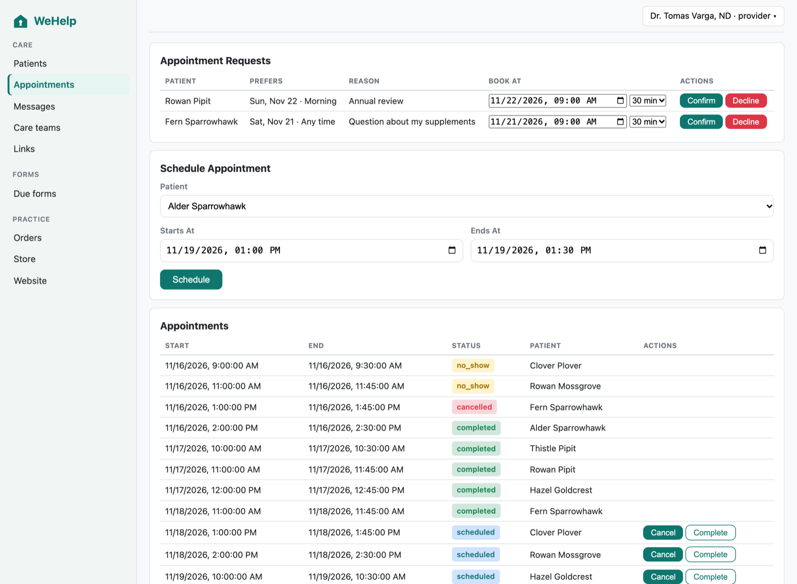
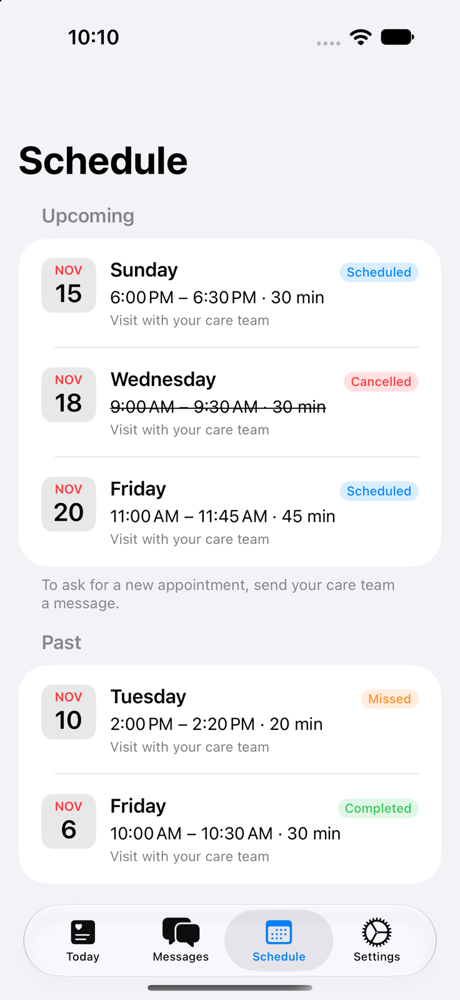
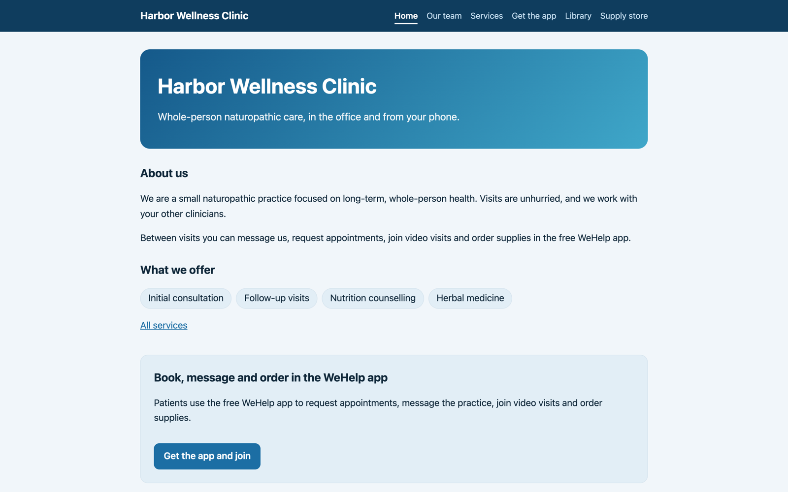

# WeHelp

### Built by providers, for providers.

We have spent the last 30 years in healthcare services technology and patient
services, and licensed providers sit on our board of directors and shape what
we build.

Open source software suite for healthcare providers — the backend they want and
deserve. Providers and patients connect, share health data, schedule visits,
exchange memos and check-ins, and sync readings from Bluetooth health
monitors.

<table>
  <tr>
    <td width="44%"><a href="https://zacharyelston.github.io/WeHelp/#8"></a></td>
    <td width="18%"><a href="https://zacharyelston.github.io/WeHelp/#6"></a></td>
    <td width="38%"><a href="https://zacharyelston.github.io/WeHelp/#11"></a></td>
  </tr>
  <tr>
    <td align="center">Staff web: the provider's day</td>
    <td align="center">iPhone app</td>
    <td align="center">Practice website, six themes</td>
  </tr>
</table>

**[See the full presentation →](https://zacharyelston.github.io/WeHelp/)**
Who we are, how it works, the product screen by screen, security, getting started and where the build stands.

Designed to run on an appliance PC in a provider's office (one Go binary +
Postgres, ~500 patients per practice). A cloud-hosted tier runs the same
artifact — but the on-prem box is the reference deployment, not an
afterthought. Includes an internal credit system for tracking resource spend.

## Layout

```
cmd/wehelp/           Go CLI entrypoint (cobra + viper)
internal/
  audit/              hash-chained, append-only audit events
  config/             viper configuration (WEHELP_* env, wehelp.yaml)
  ledger/             double-entry internal credit ledger
  seed/               idempotent demo data seeder
  server/             chi HTTP API + embedded staff web UI
  store/              pgx pool (migrations are Flyway's job — see db/)
db/migrations/        Flyway SQL migrations (V{n}__name.sql)
api/openapi.yaml      OpenAPI 3.0 spec — the API contract
web/                  staff web UI (vanilla JS SPA, embedded in the Go binary)
ios/                  SwiftUI app (project generated by xcodegen)
deploy/               Dockerfile + docker-compose for on-prem
docs/ARCHITECTURE.md  design decisions and data model
```

## Quickstart

```sh
# Postgres + API via Docker
make compose-up

# or run locally against your own Postgres
make db-migrate             # containerized Flyway (or: brew install flyway; ./bin/wehelpd migrate)
make build
./bin/wehelpd serve         # listens on :8080 — schema must already be migrated

# seed a demo tenant, provider, two patients, a link, messages, and an
# appointment — idempotent, prints credentials to stdout
make seed

# open the web client in your browser
open http://localhost:8080   # log in with the demo credentials from `make seed`

# iOS app
make ios                    # generates WeHelp.xcodeproj, opens Xcode
```

`make seed` is idempotent: re-running it against an already-seeded database
performs no writes and appends no duplicate audit events. It applies
migrations first, so it works against a fresh `make compose-up` stack. The
demo credentials it prints (tenant, emails, passwords) let you log in
immediately:

```sh
# log in as the demo provider
curl -s localhost:8080/api/v1/auth/login \
  -H 'content-type: application/json' \
  -d '{"tenant":"Demo Clinic","email":"dr.ada.shaw@demo.wehelp","password":"wehelp-demo-provider"}'

# then call an authenticated endpoint with the returned access_token
curl -s localhost:8080/api/v1/me -H 'authorization: Bearer <access_token>'
```

Config: `wehelp.yaml` or `WEHELP_*` environment variables
(`WEHELP_DATABASE_URL`, `WEHELP_LISTEN_ADDR`, ...). See `internal/config`.

## License

[AGPL-3.0](LICENSE) — chosen so hosted/on-prem forks must contribute back.
If the project later prefers a permissive license, swap before accepting
outside contributions.
